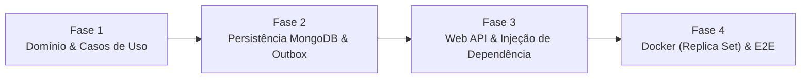

# 🗺️ Roadmap — Primeiro Entregável (MVP: API de Gestão de Encomendas)

Este documento define a agenda sequencial de implementação para atingir o **Primeiro Entregável (MVP)** do **Concierge.Net**:
> **Objetivo do Entregável:** Uma Web API funcional ponta a ponta capaz de receber os comandos correspondentes ao ciclo de vida e eventos da entidade `Package` (`Receive`, `Collect`, `Cancel`), persistindo estado e Outbox de forma transacional no MongoDB e processando os eventos em background com rastreabilidade (`CorrelationId`).

---

## 📊 Visão Geral das Fases

---

## ✅ O que já está pronto (Baseline Atual)
- [x] Estrutura base de DDD (`Entity`, `AggregateRoot`, `IAggregateRoot`, `ValueObject`, `Id<T>`, `DomainEvent`).
- [x] Agregado `Package` com criação (`Receive`) e retirada (`MarkAsCollected`), gerando `PackageReceivedDomainEvent` e `PackageCollectedDomainEvent`.
- [x] Comando `ReceivePackageCommand` e `ReceivePackageCommandHandler` integrados com `IPackageRepository` e `IUnitOfWork`.
- [x] `UnitOfWork` e `PackageRepository.Add` com suporte a transação MongoDB (`IClientSessionHandle`).
- [x] Event Handlers de notificação (`PackageReceivedEventHandler`, `PackageCollectedEventHandler`) com `FakeEmailService`.
- [x] Decorators de Logging estruturado padronizados (`CommandHandlerLoggingDecorator`, `QueryHandlerLoggingDecorator`, `DomainEventHandlerLoggingDecorator`) e `CorrelationContext`.

---

## 🚀 Fase 1: Fechamento do Domínio e Casos de Uso de `Package`
**Foco:** Garantir que todas as transições de estado da entidade `Package` possuem comandos, queries e handlers correspondentes na camada `Application`.

### 1.1. Completar Ciclo de Vida no Domínio (`Concierge.Net.Domain`)
- [x] Revisar `Package.MarkAsCollected`: utilizar o parâmetro `collectedAtUtc` na atribuição de `CollectedAtUtc` (atualmente sobrescreve com `DateTime.UtcNow`).
- [x] Implementar o estado de **Cancelamento** previsto no `README.md` (`Received → Cancelled`):
  - [x] Criar evento `PackageCancelledDomainEvent`.
  - [x] Adicionar propriedade `DateTime? CancelledAtUtc` e `bool IsCancelled` em `Package`.
  - [x] Criar método de domínio `Package.Cancel(...)` validando regras de invariância (não cancelar pacote já retirado e não retirar pacote cancelado).

### 1.2. Evoluir Contrato do `IPackageRepository` (`Concierge.Net.Application`)
- [x] Adicionar `Task<Package?> GetByIdAsync(PackageId id, CancellationToken ct)` (necessário para carregar o pacote antes de coletar ou cancelar).
- [x] Adicionar `void Update(Package package)` (para registrar a atualização de estado no `UnitOfWork`).

### 1.3. Implementar Comandos, Queries e Event Handlers faltantes (`Concierge.Net.Application`)
- [x] **Coleta de Encomenda (`Collect`):**
  - [x] Criar `CollectPackageCommand` (contendo `PackageId`, `CollectedByResidentId`, `SignatureHash`, `NotificationEmail`).
  - [x] Criar `CollectPackageCommandHandler` (busca o pacote via `GetByIdAsync`, executa `package.MarkAsCollected(...)`, chama `_repository.Update(package)` e `_unitOfWork.CommitAsync`).
- [x] **Cancelamento de Encomenda (`Cancel`):**
  - [x] Criar `CancelPackageCommand` e `CancelPackageCommandHandler`.
  - [x] Criar `PackageCancelledEventHandler` para notificar o cancelamento.
- [x] **Consulta de Encomenda (`GetPackage`):**
  - [x] Remover a duplicidade da classe `GetPackageResponse` (manter apenas uma definição com as propriedades de retorno: `Id`, `ResidentId`, `UnitId`, `ReceivedAtUtc`, `CollectedAtUtc`, `CancelledAtUtc`, `Status`).
  - [x] Implementar a lógica de busca em `GetPackageQueryHandler`.

---

## 🗄️ Fase 2: Persistência MongoDB e Processamento do Outbox
**Foco:** Garantir que o MongoDB consiga serializar/desserializar o agregado `Package` e seus eventos, e que o `OutboxProcessor` consuma a collection `"outbox"`.

### 2.1. Mapeamento BSON (`Concierge.Net.Infraestructure`)
- [x] Configurar `BsonClassMap` e `BsonSerializer` para os Value Objects e IDs fortemente tipados (`PackageId`, `ResidentId`, `UnitId`, `Email`), mantendo a camada `Domain` livre de dependências do driver do MongoDB.
- [x] Registrar os tipos derivados de `DomainEvent` (`PackageReceivedDomainEvent`, `PackageCollectedDomainEvent`, `PackageCancelledDomainEvent`) no mapeamento polimórfico do BSON.

### 2.2. Completar `PackageRepository` (`Concierge.Net.Infraestructure`)
- [x] Implementar `GetByIdAsync(PackageId id, CancellationToken ct)` consultando a collection `"packages"`.
- [x] Implementar `Update(Package package)` registrando `ReplaceOneAsync` no `UnitOfWork`.

### 2.3. Implementar `OutboxRepository` e Modelo de Persistência do Outbox
- [x] Definir documento/envelope do Outbox (`OutboxMessage` com `ProcessedAtUtc` na collection `"outbox"`).
- [x] Implementar `OutboxRepository.GetUnprocessed()` buscando eventos pendentes no MongoDB.
- [x] Implementar `OutboxRepository.MarkAsProcessed(Guid eventId)` atualizando o registro na collection `"outbox"`.
- [x] Implementar `OutboxRepository.AddAsync` e unificar modelo com o `UnitOfWork`.

### 2.4. Despacho de Eventos e Worker do Outbox
- [x] Implementar `DomainEventDispatcher : IDomainEventDispatcher` resolvendo os `IDomainEventHandler<TEvent>` registrados no container de DI.
- [x] Atualizar `OutboxProcessor` para despachar os eventos lidos via `IDomainEventDispatcher` (acionando os EventHandlers da aplicação) e `IMessageBus`.
- [x] Criar um `BackgroundService` (`OutboxBackgroundWorker`) que executa `OutboxProcessor.ProcessAsync()` periodicamente.

---

## 🌐 Fase 3: Camada de Apresentação — Web API & Injeção de Dependência
**Foco:** Expor os comandos e queries via HTTP e conectar todas as peças no container de Injeção de Dependência.

### 3.1. Criação do Projeto `Concierge.Net.Api`
- [x] Criar projeto `src/Concierge.Net.Api` (`Microsoft.NET.Sdk.Web`, `net10.0`) e adicioná-lo ao `Concierge.Net.slnx`.
- [x] Referenciar `Concierge.Net.Application` e `Concierge.Net.Infraestructure`.

### 3.2. Endpoints REST de `Package`
- [x] `POST /api/packages` → Recebe payload e executa `ICommandHandler<ReceivePackageCommand, PackageId>` (Retorna `201 Created`).
- [x] `POST /api/packages/{id:guid}/collect` → Executa `ICommandHandler<CollectPackageCommand, PackageId>` (Retorna `200 OK`).
- [x] `POST /api/packages/{id:guid}/cancel` → Executa `ICommandHandler<CancelPackageCommand, PackageId>` (Retorna `200 OK`).
- [x] `GET /api/packages/{id:guid}` → Executa `IQueryHandler<GetPackageQuery, GetPackageResponse>` (Retorna `200 OK` ou `404 Not Found`).

### 3.3. Composição do Container de DI e Pipeline HTTP
- [x] Configurar conexão do MongoDB (`IMongoClient` como Singleton, `IMongoDatabase` e `UnitOfWork` como Scoped).
- [x] Registrar Repositórios, CommandHandlers, QueryHandlers e DomainEventHandlers.
- [x] Encapsular os Handlers com os Decorators de Logging (`CommandHandlerLoggingDecorator`, `QueryHandlerLoggingDecorator`, `DomainEventHandlerLoggingDecorator`).
- [x] Criar Middleware de `CorrelationId` (lê header `X-Correlation-Id` da requisição ou gera um novo `Guid`, aplica em `CorrelationContext.Set(...)` e devolve no response header).

---

## 🐳 Fase 4: Ambiente Local (Docker) e Validação End-to-End
**Foco:** Garantir que a aplicação rode localmente com suporte a transações do MongoDB e tenha tratamento adequado de erros HTTP.

### 4.1. Infraestrutura Local (`docker-compose.yml`)
- [x] Criar `docker-compose.yml` na raiz do repositório com o **MongoDB configurado em modo Replica Set (`rs0`)** — pré-requisito obrigatório do MongoDB para aceitar transações multi-documento (`StartTransaction` no `UnitOfWork`).

### 4.2. Resiliência e Padronização HTTP
- [x] Configurar tratamento global de exceções (`GlobalExceptionHandler : IExceptionHandler` / `ProblemDetails`) para mapear violações de domínio (`InvalidOperationException` → `409 Conflict`, `ArgumentException` → `400 Bad Request`, `KeyNotFoundException` → `404 Not Found`).

### 4.3. Checklist de Aceite do Primeiro Entregável (Definition of Done)
- [ ] `POST /api/packages` grava documento em `"packages"` e evento `PackageReceivedDomainEvent` em `"outbox"` na mesma transação.
- [ ] Worker do Outbox consome o evento pendente, dispara `PackageReceivedEventHandler` (exibindo o e-mail simulado no console) e marca o evento como processado.
- [ ] `POST /api/packages/{id}/collect` atualiza o pacote para coletado, grava `PackageCollectedDomainEvent` no Outbox e dispara a notificação correspondente.
- [ ] Tentativa de coletar um pacote já coletado ou cancelado retorna erro HTTP adequado (`400`/`409`) sem sujar o Outbox.
- [ ] Todos os logs do ciclo mostram o `CorrelationId`, `Request` e `EventId` estruturados.
